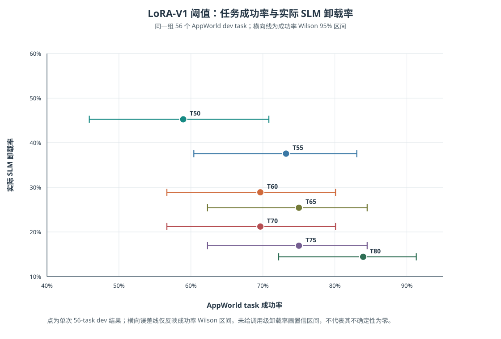

# OpenJev AppWorld LoRA 阈值实验总结

**整理日期：** 2026-11-12  
**模型：** OpenJev-1.7B AppWorld V1 LoRA checkpoint `appworld-v1-context-r16-lr5e-5-seed0-20261107`  
**任务集：** 同一组 56 个官方 AppWorld dev tasks，每个阈值各运行一次  
**范围：** T50/T55/T60/T65/T70/T75/T80 端到端路由实验；报告成功率、真实模型派发、失败检查、token、耗时与执行模型费用估算。结论仅适用于该 dev task 集。

## 摘要

七个阈值作业最终都获得了 **56/56 条任务结果**，各自 smoke gate 通过，`consumption_complete=true`，无无效测量。T75 首次作业 `592733` 在正式批次开始前因模型 endpoint 连接失败而中止，没有 task 结果；随后以新作业 `617494`、更新的可达服务地址成功完成。本报告的 T75 数值只使用 `617494`，没有将首次失败尝试混入结果。

在这 56 个 dev task 上，成功率最高的是 **T80：47/56（83.9%）**，实际 SLM 卸载率为 **14.4%**；卸载率最高的是 **T50：45.3%**，成功率为 **58.9%**。其余点并非严格单调：T55 高于 T50，T65 高于 T60/T70，T75 与 T65 均为 75.0%。提高阈值总体降低 SLM 派发比例，但 56 个任务中的成功数会受具体步骤路由、执行轨迹和模型输出影响，不保证逐阈值单调变化。

逐任务失败归因使用 AppWorld evaluator 报告，并将每个任务最后 Agent step 的 `accepted_model_attempt_id` 关联到 SQLite `span_records.execution_summary.model_attempts` 中的实际模型 ID。109 个失败的 task-threshold 单元里，**最后 Agent step 的 accepted 模型为 SLM 100 项、LLM 6 项；另有 3 项在步数/执行结束时没有提交 `supervisor.complete_task`（最后一条生成分别由 LLM 2 项、SLM 1 项接受）**。这表示失败任务最后一步实际接受了哪一模型，不代表该模型单独造成了此前任务状态错误；多数失败轨迹都用过两种模型。

## 实验设置与口径

- **输入与提示词：** V1 context-choice 请求；每次判断只针对下一次模型调用，criteria 为 `LLM` / `SLM`，原有执行守卫与 LLM fallback 保留。
- **目标执行模型：** Qwen3.8-27B（LLM）与 Qwen3.5-9B（SLM）。Jev 是本地微调 OpenJev-1.7B checkpoint；七组阈值除 threshold 外共用该 checkpoint、提示词、任务 manifest 与 runner 设置。
- **样本与配对：** 每阈值相同 56 个 task ID、顺序一致，每个 task 单次运行。不同阈值的 task-level 成败可配对比较，但单次 Agent 生成仍可能有随机性。
- **成功率：** AppWorld evaluator 所有必要检查均通过的任务数 / 56。答案断言或环境状态断言任一失败，整个任务判失败。
- **实际卸载率：** 框架真实派发给 SLM 的调用数 /（SLM 实际调用数 + LLM 实际调用数）；不是 Jev 的概率或原始路由意图。
- **平均 P(SLM)：** 所有成功 Jev 响应的 `mean_slm_probability` 按每行成功响应数加权。它不等于卸载率；应用阈值和守卫后才形成实际派发。
- **成本：** 使用比较器中的 OpenRouter 2026-10 执行模型 token 价，从 Qwen 输入/输出 token 估算；不是账单，不包括 Jev 推理、A800/GPU、排队或基础设施成本。
- **时间：** 端到端平均/中位数按 56 个 `e2e_wall_clock_ms` 计算；任务并非并行执行。

### 作业与产物

| 阈值 | Slurm 作业 | 状态 | 运行时长 | 结果目录 |
|---|---:|---|---:|---|
| T50 | `592509` | COMPLETED, exit 0 | 2:24:02 | `runs/jev-lora-v1-lora-v1-t50-592509/comparison/` |
| T55 | `592731` | COMPLETED, exit 0 | 2:50:24 | `runs/jev-lora-v1-lora-v1-t55-592731/comparison/` |
| T60 | `592510` | COMPLETED, exit 0 | 2:13:17 | `runs/jev-lora-v1-lora-v1-t60-592510/comparison/` |
| T65 | `592732` | COMPLETED, exit 0 | 2:17:26 | `runs/jev-lora-v1-lora-v1-t65-592732/comparison/` |
| T70 | `592511` | COMPLETED, exit 0 | 2:24:22 | `runs/jev-lora-v1-lora-v1-t70-592511/comparison/` |
| T75 | `617494` | COMPLETED, exit 0 | 2:17:28 | `runs/jev-lora-v1-lora-v1-t75-617494/comparison/` |
| T80 | `592512` | COMPLETED, exit 0 | 2:21:35 | `runs/jev-lora-v1-lora-v1-t80-592512/comparison/` |

T75 首次尝试 `592733`（20:33）没有生成 smoke acceptance 或正式 task 结果，日志没有记录 Jev 模型列表 ready；之后重跑 `617494` 才完成。首次尝试仅作为操作失败记录，不计作阈值测量，也没有覆盖原目录。

## 七阈值主结果

| 阈值 | 成功 | 失败 | 成功率 | 实际 SLM 卸载率 | SLM / LLM 调用 | 平均 P(SLM) | 端到端均值 / 中位数 | 执行模型费用估算 / 任务 | 执行模型 token 总数 | 遥测 |
|---:|---:|---:|---:|---:|---:|---:|---:|---:|---:|---|
| T50 | 33/56 | 23 | 58.9% | **45.3%** | 386 / 467 | 50.32% | 123.3 / 109.4 秒 | $0.0426 | 8,327,763 | 完整 |
| T55 | 41/56 | 15 | 73.2% | 37.6% | 305 / 507 | 49.60% | 160.5 / 141.5 秒 | **$0.0416** | 7,739,431 | 完整 |
| T60 | 39/56 | 17 | 69.6% | 28.9% | 230 / 566 | 49.08% | **114.7 / 104.6 秒** | $0.0451 | 7,655,508 | 完整 |
| T65 | 42/56 | 14 | 75.0% | 25.4% | 194 / 569 | 49.52% | 118.2 / 109.0 秒 | $0.0453 | **7,372,327** | 完整 |
| T70 | 39/56 | 17 | 69.6% | 21.2% | 168 / 624 | 50.56% | 121.8 / 108.1 秒 | $0.0493 | 7,842,723 | 完整 |
| T75 | 42/56 | 14 | 75.0% | 16.9% | 133 / 653 | 50.87% | 119.4 / 105.7 秒 | $0.0524 | 8,076,339 | 完整 |
| T80 | **47/56** | **9** | **83.9%** | 14.4% | 112 / 664 | 51.41% | 125.6 / 113.6 秒 | $0.0532 | 8,126,921 | 完整 |

成本估算的每组总额约为：T50 `$2.385`、T55 `$2.332`、T60 `$2.528`、T65 `$2.539`、T70 `$2.760`、T75 `$2.933`、T80 `$2.977`。T55 的 token 费用最低、T80 最高；这是调用模型的估算费用，不含 Jev 服务成本或 GPU 成本。

图中横向线为成功率的 Wilson 95% 区间，仅用于展示每组 56 项下比例估计的不确定性；卸载率按模型调用计数，未画调用级置信区间。区间广泛重叠，因此不应把几项任务的点估计差异宣称为统计显著。

## 观察与解释

1. **整体呈现成功率与卸载之间的权衡。** T50 卸载率最高（45.3%），成功率最低（58.9%）；T80 成功率最高（83.9%），卸载率最低（14.4%）。T80 相比 T50 多成功 14 项，卸载率低 30.8 个百分点；执行模型 token 费用/组高 `$0.592`。
2. **中间阈值不是单调曲线。** T55（73.2%）高于 T50，T65（75.0%）高于 T60/T70，T75 与 T65 成功数相同。相邻阈值逐任务配对中，T55 相对 T60 有 6 项只在 T55 成功、4 项只在 T60 成功；T65 相对 T70 有 5 项只在 T65 成功、2 项只在 T70 成功。其余任务状态相同。这是单次生成的经验现象，不说明阈值越低普遍更好。
3. **平均 P(SLM) 随阈值微升，实际卸载率明显下降。** P(SLM) 全组均值约在 49.1–51.4%，而实际 SLM 派发从 45.3% 降至 14.4%。这并不矛盾：实际卸载还受阈值、守卫检查和 fallback 影响。
4. **更高阈值下 P(SLM) 仍高于阈值的调用会被执行。** 例如 T80 仍有 112 次 SLM 派发；每个已接受的 SLM 尝试经过已有 guard。七组 guard 后回退数分别为 T50 41、T55 29、T60 24、T65 12、T70 12、T75 2、T80 3 次（这些是模型调用级回退，不是回退任务数）。
5. **耗时没有随阈值单调变化。** T55 平均 160.5 秒较长，T60 最短（114.7 秒）；端到端任务耗时会受工具调用数、模型输出和任务本身影响，不能只从阈值或模型 latency 推断。

## 失败归因：评测断言与最后 accepted model

### 评测器指出的失败类型

`evaluation_failed` 是聚合原因，不等于每个失败都只错在最终文字答案。逐个 `evaluation/report.md` 的失败断言按 task-threshold 归类如下；一个失败任务可能同时属于多个类别，因此列间会重叠。七组共 109 个失败 task-threshold 单元，表中类别断言共 125 项：

| 阈值 | 失败 task 数 | 最终答案断言不匹配 | 电话/通知状态 | Spotify 状态 | 交易状态 | 文件状态 |
|---:|---:|---:|---:|---:|---:|---:|
| T50 | 23 | 14 | 5 | 3 | 4 | 1 |
| T55 | 15 | 11 | 2 | 3 | 2 | 1 |
| T60 | 17 | 13 | 1 | 2 | 3 | 0 |
| T65 | 14 | 13 | 1 | 3 | 0 | 0 |
| T70 | 17 | 14 | 0 | 4 | 0 | 1 |
| T75 | 14 | 10 | 0 | 3 | 1 | 1 |
| T80 | 9 | 7 | 0 | 2 | 0 | 0 |

最终答案不匹配的例子是 evaluator 的 `assert answers match.` 失败；状态类包括收件人/通知内容与目标不符、下载或点赞的歌曲集合不符、交易记录金额/ID 不符、文件状态检查不符。AppWorld 的所有必要断言需通过才算任务成功，所以仅有一项失败也会将整项任务计为失败。

### 最后 Agent 输出的实际模型归因

下面通过 `logger.jsonl` 最后 Agent step，关联同编号 `episode-k` 的 SQLite `span_records.execution_summary.accepted_model_attempt_id`，并读取该 attempt 的 `model_ref`。这是**最后 Agent 生成步骤实际接受的模型**，不表示它单独造成整条任务失败。少数任务在步数/执行结束时没有调用 `supervisor.complete_task`；这些行单独标为“未提交最终完成调用”，不伪称已有最终答案。

| 阈值 | 失败任务最后 Agent step 接受 SLM | 接受 LLM | 未提交完成调用 | 失败轨迹中用过两种模型 | 任一步发生过 SLM→LLM fallback |
|---:|---:|---:|---:|---:|---:|
| T50 | 21 | 1 | 1（最后 step LLM） | 22/23 | 13/23 |
| T55 | 13 | 1 | 1（最后 step LLM） | 15/15 | 6/15 |
| T60 | 15 | 1 | 1（最后 step SLM） | 16/17 | 8/17 |
| T65 | 13 | 1 | 0 | 13/14 | 2/14 |
| T70 | 16 | 1 | 0 | 16/17 | 4/17 |
| T75 | 13 | 1 | 0 | 13/14 | 2/14 |
| T80 | 9 | 0 | 0 | 9/9 | 0/9 |

这里“用过两种模型”与“最后一次输出模型”不同：多数失败轨迹混合使用了 SLM 和 LLM。T50–T75 的一些失败轨迹中曾发生守卫 fallback，但最后 Agent step 仍可能由 SLM 接受；也有 T55 的一个 Spotify 失败，其最后一步由 LLM 接受。因此不能将整条失败简单归为“SLM 失败”或“LLM 失败”。

### 失败 task 明细

代码：`A`=最终答案断言；`S`=电话/通知副作用；`P`=Spotify 状态；`V`=Venmo/交易状态；`F`=文件状态。模型标记是最后 Agent step 的 accepted model：`S`=Qwen3.5-9B，`L`=Qwen3.8-27B，`no-final-L/S`=最后 step 没有提交 `supervisor.complete_task`。多个代码表示 evaluator 同时报告了多类错误。

| 阈值 | 失败 task：`task_id:model类别` |
|---:|---|
| T50 | `0d8a4ee_2:no-final-L[AS]`; `0d8a4ee_3:S[S]`; `37a8675_1:S[ASV]`; `37a8675_2:S[A]`; `383cbac_2:S[A]`; `383cbac_3:S[A]`; `396c5a2_2:S[A]`; `396c5a2_3:S[A]`; `3ab5b8b_2:S[P]`; `3ab5b8b_3:S[P]`; `4ec8de5_1:L[A]`; `4ec8de5_3:S[A]`; `4fab96f_1:S[A]`; `4fab96f_2:S[S]`; `4fab96f_3:S[AS]`; `530b157_2:S[V]`; `57c3486_1:S[P]`; `57c3486_2:S[A]`; `57c3486_3:S[A]`; `68ee2c9_2:S[F]`; `6c2c621_1:S[A]`; `df61dc5_2:S[V]`; `df61dc5_3:S[V]` |
| T55 | `37a8675_2:S[ASV]`; `383cbac_1:S[A]`; `383cbac_2:S[A]`; `383cbac_3:no-final-L[A]`; `396c5a2_2:S[A]`; `396c5a2_3:S[A]`; `3ab5b8b_2:L[P]`; `3ab5b8b_3:S[AP]`; `4fab96f_2:S[S]`; `530b157_2:S[A]`; `57c3486_1:S[P]`; `68ee2c9_1:S[AF]`; `6c2c621_1:S[A]`; `b119b1f_2:S[A]`; `df61dc5_3:S[V]` |
| T60 | `37a8675_1:S[ASV]`; `37a8675_2:S[A]`; `383cbac_1:S[A]`; `383cbac_2:no-final-S[A]`; `396c5a2_1:S[A]`; `396c5a2_2:S[A]`; `396c5a2_3:S[A]`; `3ab5b8b_2:S[A]`; `3ab5b8b_3:S[P]`; `4ec8de5_1:L[A]`; `57c3486_1:S[A]`; `68ee2c9_2:S[A]`; `6c2c621_1:S[A]`; `b119b1f_2:S[P]`; `b119b1f_3:S[A]`; `df61dc5_2:S[V]`; `df61dc5_3:S[V]` |
| T65 | `0d8a4ee_1:S[AS]`; `0d8a4ee_2:S[A]`; `37a8675_2:S[A]`; `383cbac_1:S[A]`; `383cbac_2:S[A]`; `396c5a2_1:S[A]`; `396c5a2_2:S[A]`; `396c5a2_3:S[A]`; `3ab5b8b_2:S[AP]`; `3ab5b8b_3:S[P]`; `4ec8de5_1:L[A]`; `57c3486_1:S[AP]`; `6c2c621_1:S[A]`; `df61dc5_3:S[A]` |
| T70 | `0d8a4ee_1:S[A]`; `0d8a4ee_2:S[A]`; `37a8675_2:S[A]`; `37a8675_3:S[A]`; `383cbac_2:S[A]`; `396c5a2_1:S[A]`; `396c5a2_2:S[A]`; `396c5a2_3:S[A]`; `3ab5b8b_2:S[AP]`; `3ab5b8b_3:S[P]`; `4ec8de5_1:L[A]`; `57c3486_1:S[AP]`; `57c3486_3:S[A]`; `6171bbc_2:S[A]`; `68ee2c9_2:S[F]`; `6c2c621_1:S[A]`; `b119b1f_2:S[P]` |
| T75 | `37a8675_2:S[A]`; `37a8675_3:S[A]`; `383cbac_1:S[A]`; `396c5a2_1:S[A]`; `396c5a2_2:S[A]`; `3ab5b8b_2:S[AP]`; `3ab5b8b_3:S[P]`; `4ec8de5_1:L[A]`; `530b157_3:S[V]`; `57c3486_1:S[P]`; `6171bbc_2:S[A]`; `68ee2c9_2:S[F]`; `6c2c621_1:S[A]`; `b119b1f_3:S[A]` |
| T80 | `0d8a4ee_2:S[A]`; `37a8675_3:S[A]`; `383cbac_1:S[A]`; `383cbac_2:S[A]`; `3ab5b8b_2:S[P]`; `3ab5b8b_3:S[P]`; `530b157_2:S[A]`; `57c3486_1:S[A]`; `6c2c621_1:S[A]` |

**注意：** `A/S/P/V/F` 是失败断言的主题标签，不表示单一根因。比如某轨迹在早期步骤由一个模型生成错误操作，之后由另一个模型完成最终回答；最终 accepted model 不能替代逐步因果分析。`SLM→LLM fallback` 也只说明该任务某一步发生回退，不证明失败由该回退或回退前模型造成。

### 已缓存的步骤级案例与证据范围

目前可在本地复查的逐步日志不完整，完整 `logger.jsonl`、逐次 routing JSONL 和 `history.sqlite3` 留在服务器任务目录。已取回并检查的 T50 样本 `0d8a4ee_2` 显示：Agent 一共到达 40 步上限，整项任务中有 32 次 LLM 调用、8 次 SLM 调用，发生过 2 次 SLM fallback；最后一个 Agent step 的 accepted attempt 是 Qwen3.8-27B，但最后内容仍在反复查 Venmo `show_profile` API 文档，没有调用 `supervisor.complete_task`。Evaluator 报告答案为 `null`，且电话消息相关状态检查也失败。因此这个样本不是“LLM 已提交最终答案但答案错”，而是 Agent 在最终完成前陷入重复探索/未完成轨迹；末次模型是 LLM，也不能据此推断“LLM 导致任务失败”。

本地缓存的 T50 evaluator 报告覆盖 19 个失败样本；这 19 个都包含 `assert answers match` 失败，其中若干同时有额外状态断言失败。其余阈值的完整逐步日志未同步到本地，本报告里的模型归因表基于先前查询时服务器 SQLite span records 与 logger 的关联汇总，不是本地保存了全部逐步原始日志。若要做跨阈值逐步根因审计，需要服务器连接恢复后重新抽取/核查七组失败轨迹；当前的类别计数和实际最后 accepted model 可以支持描述，不足以证明单个模型的因果责任。

## 结论与建议

- 若目标优先是本 dev 集任务成功率，T80 是七点中最高的经验点（83.9%），代价是实际卸载率最低（14.4%）、模型 token 成本估算最高之一（约 `$2.977/组`）。
- 若目标要同时保留较高卸载，T55 是折中候选之一：73.2% 成功、37.6% 实际卸载、约 `$2.332/组`；但 T65 的成功率更高（75.0%），卸载率更低（25.4%），费用略高。两者都不是统计上确认的最优点。
- 56 项 dev 样本的 Wilson 区间较宽且大量重叠；各组只运行一次。下一步应冻结少数候选，在独立 test/holdout 上与 seed checkpoint 做相同任务、相同服务配置的配对对照，不要继续在 dev 上反复挑阈值。
- 失败明细显示最后 Agent step 多数接受 SLM 输出，但失败轨迹常用过两种模型。要验证“SLM 是否导致端到端失败”，需做逐调用模型消融或原始 seed/微调模型同 task 配对实验；仅按最终一步模型分组不能证明因果。

## 完整性、来源与边界

- 七组每组 `tasks=56`，同一 task manifest；`complete=true`，`consumption_complete=true`，`invalid_measurement_tasks=0`，每组验收 `ready_for_batch=true`。
- 有效作业 ID：T50 `592509`、T55 `592731`、T60 `592510`、T65 `592732`、T70 `592511`、T75 `617494`、T80 `592512`。T75 初次失败 `592733` 没有 smoke acceptance 和正式结果，不进入阈值数据。
- 比较器基础 HEAD 为 `8e4fe5b`；运行时 `source-snapshot.json` 记录了实际源码 SHA-256 和 dirty worktree 状态。复现应使用各 run 目录中的 config、manifest、source snapshot 与结果，不能只凭 HEAD 字符串。
- 七阈值均是 `development_experiment=true`、`holdout_evaluation=false`。结果不代表未见任务分布的无偏成功率，也不等于线上 SLA。
- 成本采用执行模型 token 的列表价估算，不包括 Jev 模型服务、A800、队列等待、数据与基础设施成本。

## 复现产物

每组远端目录为 `/share/home/shenwsh3/ozy/span-offload-jev-prompts/runs/jev-lora-v1-lora-v1-t{50,55,60,65,70,75,80}-<job_id>/comparison/`，包含 `manifest.json`、配置、smoke acceptance、逐任务 `results.json`、进度日志和汇总 `report.json`。失败 task 的 AppWorld evaluator 报告位于相应 AppWorld experiment output 的 `tasks/<task_id>/evaluation/report.md`；实际 accepted model attempt 位于该任务的 `classifier_route/history.sqlite3`。
