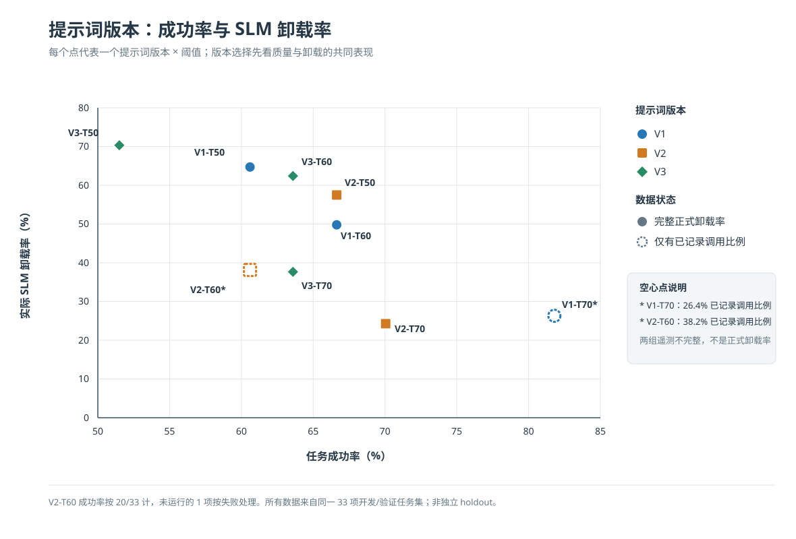

# Jev 提示词版本总对照

**整理日期：** 2026-11-05  
**比较目的：** 先比较 V1/V2/V3 提示词版本，评估任务成功率与实际 SLM 卸载率的共同表现；阈值作为版本内部策略细分，不据此先行确定单一阈值。

## 结论摘要

1. **V3 是当前三阈值遥测完整的版本。** 三组均 33/33 完成：T50 为 51.5% 成功率、70.4% 卸载率；T60 为 63.6%、62.4%；T70 为 63.6%、37.3%。V3-T60 在本批 V3 结果中最均衡。
2. **V2-T50 是当前较强的跨版本折中候选。** 成功率 66.7%、卸载率 57.5%，均高于 V3-T60 的 63.6%、62.4% 中的成功率但卸载率低 4.9 个百分点。两者互不支配，不应压成一个没有预先定义权重的总分。
3. **V1-T70 已补跑完整任务清单，但补跑中的一个任务仍有无效消费遥测。** 补跑作业 `573055` 于 2026-11-01 完成（Slurm `COMPLETED`，2:03:21），manifest、results、progress 均为 33/33，结果为 27/33 成功。补跑任务 `fb05fed_3` 再次达到任务超时上限：任务结果计为失败，且保留了中断前已返回的 9 次 SLM、22 次 LLM 调用；但该行 `consumption_complete=false`、`valid_for_comparison=false`，原因是 `interrupted_consumption` 和 `jev_instrumentation_unavailable`。所以**任务结果覆盖完整，不等于消费遥测完整**：完整实际卸载率仍为 `null`，26.4% 只是已记录调用中的 SLM 比例。该无效遥测项就是同一个超时任务，不是另一个缺失任务。
4. **V2-T60 尚未实测完整。** 修正补跑作业 `577737` 已于 2026-11-03 11:05:29 CST 取消，Slurm 记账为 `CANCELLED`、运行时间 0 秒。缺失的 `fdc4b74_1` 按失败计入成功率分母：20/33=60.6%；它没有任何实际模型调用记录，不表示“0 次 SLM 调用”。此外已有 5 个任务运行超时、消费遥测不完整，正式卸载率仍为 `null`。已记录调用比例 38.2% 只作诊断值，不是正式卸载率。
5. **目前没有足够证据宣布唯一“最佳提示词版本”。** V1-T70 的任务结果已覆盖完整清单，但一项超时使其消费遥测和正式卸载率仍不完整；V2-T60 部分未执行且 telemetry 不完整。三版又都只在同一批 33 个开发/验证任务上各运行一次，没有独立 holdout 或重复种子。按现有完整数据，V2-T50 与 V3-T60 是优先候选；推荐先基于提示词目标选候选版本，再在 holdout 上固定阈值完成确认。

## 主要指标：先按提示词版本看

“成功数/99”是该提示词三个阈值共 99 个 task-threshold 单元上的描述性汇总。同一任务在三个阈值重复出现，故 99 个单元并非 99 个独立任务；此列用于快速概览，不是总体任务成功概率估计。V2-T60 缺失的一项按用户指定口径作为失败。

| 提示词版本 | 三阈值成功数 / 99 单元 | 任务结果覆盖 | 消费遥测完整阈值数 | 三阈值实测调用观测合计 SLM / LLM | 版本级正式卸载率 | 执行模型费用估算合计 |
|---|---:|---|---:|---:|---|---:|
| V1 | 69/99（69.7%） | 99/99 个 task-threshold 结果行；T70 使用补跑 `573055` | 2/3；T70 超时行遥测不完整 | 933 / 1,028 | 不完整；观测调用比例 47.6%（含 T70 下界） | $6.857，含 T70 下界 |
| V2 | 65/99（65.7%） | 98/99 条实测结果行；T60 缺 1 项，按用户口径计失败 | 2/3；T60 遥测不完整 | 727 / 1,066 | 不完整；已记录调用比例 40.6% 不能作为正式率 | $5.551，含 T60 部分账目 |
| V3 | 59/99（59.6%） | 99/99 个 task-threshold 结果行 | 3/3，完整 | 1,163 / 883 | **56.8%**（1,163/2,046） | $5.461 |

这里将“任务结果覆盖”与“消费遥测完整性”分开：结果行覆盖表示 manifest 中每个 task-threshold 都有结果记录；它不保证该任务的模型调用、token 和成本账目完整。费用为各阈值报告中 `estimated_execution_cost_usd` 的合计。V1-T70 和 V2-T60 遥测不完整，故相应版本的费用合计仅是已记录估算，不是完整总费用。模型费用不含 Jev 服务成本、GPU/基础设施费用，也不是账单金额。

## 按阈值展开

| 提示词 | 阈值 | 成功 / 分母 | 成功率 | 实际卸载率 | SLM / LLM 调用 | 端到端均值 / 中位数 | 执行模型费用/组 | 完整性 |
|---|---:|---:|---:|---:|---:|---:|---:|---|
| V1 | T50 | 20/33 | 60.6% | 64.7% | 439 / 240 | 204.2 / 147.3 秒 | $1.696 | 完整 |
| V1 | T60 | 22/33 | 66.7% | 49.7% | 332 / 336 | 190.6 / 167.5 秒 | $2.073 | 完整 |
| V1 | T70 | 27/33 | 81.8% | 26.4% | 162 / 452 | 152.5 / 150.6 秒 | $3.088 已记录下界 | 补跑 `573055` 有 33/33 结果行；`fb05fed_3` 超时，消费遥测无效 |
| V2 | T50 | 22/33 | 66.7% | 57.5% | 368 / 272 | 151.2 / 134.0 秒 | $1.553 | 完整 |
| V2 | T60 | 20/33* | 60.6%* | 38.2% | 216 / 350 | 27 项有 e2e 值的均值 410.3 秒 | $1.840 已记录部分 | 32/33 结果；5 超时；1 未运行按失败计 |
| V2 | T70 | 23/33 | 69.7% | 24.4% | 143 / 444 | 132.0 / 116.1 秒 | $2.158 | 完整 |
| V3 | T50 | 17/33 | 51.5% | 70.4% | 486 / 204 | 179.8 / 140.3 秒 | $1.425 | 完整 |
| V3 | T60 | 21/33 | 63.6% | 62.4% | 426 / 257 | 162.8 / 131.8 秒 | $1.694 | 完整 |
| V3 | T70 | 21/33 | 63.6% | 37.3% | 251 / 422 | 144.1 / 131.3 秒 | $2.341 | 完整 |

`*` V2-T60 的成功率采用用户指定的处理：32 项实测中 20 项成功，第 33 项未运行视为失败，按 20/33 计算。该策略只规定任务成功率的记分，不会补出未观测的模型调用，因此卸载率仍为 `null`。T60 的延迟只对 27 个有有效 e2e 完成时间的结果计算，不能与 33 项完整组直接横比。

卸载率统一按 **实际派发给 SLM 的调用数 / (SLM 实际调用数 + LLM 实际调用数)** 计算。任务超时但已有的调用仍留在调用合计中；若出现中断消费，完整实际卸载率置为 `null`，同时可以显示已记录调用比例作为诊断值，但不把它当正式率。

所以，“T70 补跑完成”指 **整组 33 个任务均有结果行且 Slurm 作业正常结束**；“消费遥测不完整、1 项无效测量”指 **这 33 行中的一个超时样本没有完整可验证的调用消费账目**。它不表示补跑没执行，也不表示 T70 缺了一整项任务；成功率分母仍为 33，超时任务按失败计入。

## 提示词版本之间的同阈值配对

每个版本的三个 manifest 使用相同 33 个 task ID。下面是逐任务成功状态对照；左胜/右胜表示仅对应一侧成功。

| 同阈值比较 | 共同任务数 | 左侧仅成功 | 右侧仅成功 | 双方成功 | 双方失败 | 成功数差 |
|---|---:|---:|---:|---:|---:|---:|
| V1-T50 → V2-T50 | 33 | 5 | 7 | 15 | 6 | V2 +2 |
| V1-T50 → V3-T50 | 33 | 6 | 3 | 14 | 10 | V3 -3 |
| V2-T50 → V3-T50 | 33 | 7 | 2 | 15 | 9 | V3 -5 |
| V1-T60 → V2-T60 | 32 | 6 | 5 | 15 | 6 | V2 -1；V2 缺 1 项 |
| V1-T60 → V3-T60 | 33 | 6 | 5 | 16 | 6 | V3 -1 |
| V2-T60 → V3-T60 | 32 | 5 | 5 | 15 | 7 | 持平；V2 含超时与缺项 |
| V1-T70 → V2-T70 | 33 | 5 | 1 | 22 | 5 | V2 -4 |
| V1-T70 → V3-T70 | 33 | 8 | 2 | 19 | 4 | V3 -6 |
| V2-T70 → V3-T70 | 33 | 6 | 4 | 17 | 6 | V3 -2 |

V1-T70 的补跑有完整 33 项任务结果，可用于任务成功配对，但 `fb05fed_3` 的消费遥测不完整；V2-T60 的 V2 侧只有 32 条实际行，表中只按共同的 32 项配对，不把“未运行失败”伪造成实际轨迹。

## 解释

- **V2 对 V1：** 同阈值 T50，V2 成功率高 6.1pp，但卸载率低 7.2pp；T70，V2 成功率低于 V1，卸载率虽有可观测比例但 V1-T70 正式卸载率无效，不能严格比较。T60 因 V2 未完成不可定论。
- **V3 对 V1：** T50/T60 成功率略低，而卸载率较高；T70 成功率低 18.2pp。V3-T70 的正式卸载率为 37.3%，高于 V1-T70 已记录调用比例 26.4%；但 V1 的 26.4% 不是完整卸载率，因此这不是有效的正式卸载率差值比较。
- **V2 对 V3：** T50 V2 成功率高 15.2pp，卸载率低 12.9pp；T70 V2 成功率高 6.1pp，卸载率低 12.9pp。T60 共同任务上成功状态打平，但 V2 有超时和未运行项，不能当完整版本结果。
- 目前若把重点放在成功率与卸载率共同较高，完整阈值中的 **V2-T50 与 V3-T60** 是 Pareto 权衡候选：V2-T50 成功率较高 3.0pp，V3-T60 卸载率较高 4.9pp。V3-T60 成本估算高约 $0.141/组；两者都不是独立 holdout 上的最终结论。
- 汇总 `69/99` 等是同一批任务在三个阈值上的重复测量汇总，99 个单元不代表 99 个独立样本。不要把版本级汇总率解释成目标任务分布的无偏概率。

## 完整性、可比性与边界

- 三个提示词版本运行于相同 33 个 manifest task ID，task ID 列表 SHA-256 均为 `6df01b12db6973d31c239f016363e9076d03cd1365b629ef6f36e7383b8a2d69`；代码均为提交 `8e4fe5b63472cbfd71b777cc93f191d519fa2792`。
- Prompt SHA-256：V1 `a520f9c99e990a6ce282dbcf29d5347ff085685953c86e394dfc1f3f21362b2a`；V2 `3af63e2a48adcd9be76204796d1c0f13de33a1d9d1d2906a7627ee057c83fc79`；V3 `bf259474f480dc2028d0eeba970f1b10e95caf588483c6625c11ad78c587ac88`。
- 服务模型 ID 按各运行配置和 model-list 验收文件记录；不同作业处于不同时间段，不能排除服务负载/时段差异。
- 所有这些都是 `development_experiment=true`、`holdout_evaluation=false` 的 33 项开发/验证结果，不是独立 holdout。
- V1-T70 正式汇总以补跑作业 `573055` 的独立输出目录为准；作业 `COMPLETED` 且结果覆盖 33/33，但其中 `fb05fed_3` 是遥测无效的超时行。补跑解决了初次运行仅有 2 条结果的覆盖问题，没有消除补跑本身的消费遥测缺口。
- T60 缺项按失败只适用于用户指定的成功率记分；它没有实际运行记录，不能为其填入 0 次模型调用或猜测卸载率。补跑作业 `577737` 已取消（0 秒），未产生新实验结果。
- 运行验收通过说明服务、路由审计与运行产物符合该作业验收，不代表 AppWorld 任务成功，也不代表统计结论可泛化。
