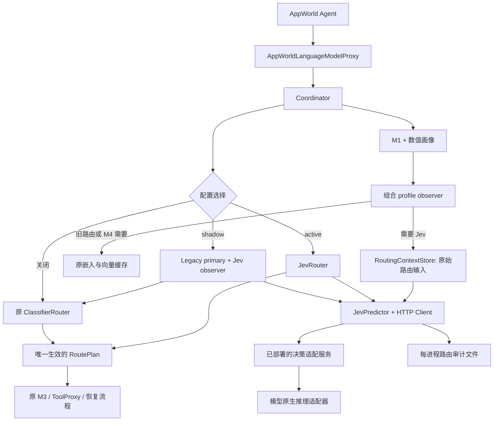

# 可选 Jev 决策模型路由设计

日期：2026-10-20。状态：已完成自审及独立评审，待进入实现；本文件中的新模块、配置和 HTTP 接口均为拟实现内容，当前尚未上线。

目标：保留现有 `l2_add4` 基线，增加一个默认关闭、通过 HTTP 调用已部署 Jev 风格模型的 M2 判断后端，支持同一 Span 的影子决策对照以及 Jev 主动控制路由。

## 1. 范围与设计决定

本次需求是设计与评审，不实现业务代码、不下载模型、不连接服务器。模型供应商未固定：适配接口应支持不同的小于 4B 的开放权重决策模型，不能把某个模型的私有推理格式写进 Coordinator。

第一版包含：

- `runner.jev.enabled` 总开关，默认 `false`；关闭时不构造 Jev 客户端、不准备 Jev 上下文、不发健康检查或推理请求。
- `runner.jev.mode=shadow|active`，开启后的默认模式为 `shadow`。
- `context_v1` / `four_features_v1` 两种输入；原生 Choice 二分类，读取 `P(SLM)` 并应用本地阈值。
- 一个版本化 HTTP 接口，部署在本机、服务器或 Slurm 计算节点均可。
- 请求异常时保守选择大模型；错误原因和推理开销完整记录。
- 保持 SLM 的 `GUARDED_SLM`、pre-commit、post-check、rollback 和 fallback 链路。
- 专用逐 Span 审计文件、每任务增量指标、离线回放与在线对照。

第一版不包含：在线训练、多个 Jev 同时投票、自动挑模型、完整双问题经济门、跨模型自动回退、在同一环境执行两条分支、将长驻模型直接嵌入 AppWorld 进程。多个 Jev 通过配置分别跑实验；双问题门控是后续单独版本，不能借用当前两个 Logit 的分数语义或阈值。

## 2. 当前实现与修改依据

以下为当前代码事实，函数名比行号更稳定。

| 文件 / 入口 | 当前职责 | 对新路径的约束 |
|---|---|---|
| `experiments/run_appworld.py::main` | 解析四种 `--mode`，装配原生 AppWorld Agent | 不增加新的 CLI mode，仍使用 `classifier_route` |
| `AppWorldPilotRunner._build_coordinator` | 注入 profiler、router、executor、profile/span observer | 目前 profile observer 仅在需要嵌入时接线，必须为 Jev 扩展 |
| `traceoffload/runner.py::PilotRunner.__init__` | 初始化嵌入、M4、add4、守卫和统计 | 依赖初始化顺序需要按实际消费者决定 |
| `PilotRunner._make_profiler` | classifier 模式下按 artifact 指定的前缀列建立数值特征 | Jev 四特征不能依赖 add4 artifact 存在 |
| `PilotRunner._observe_m4_profile` | 根据原请求构造两段文本、调用嵌入、缓存向量 | Jev 文本准备必须在独立函数中，不藏进嵌入回调 |
| `PilotRunner._l2_add4_lookup` | 116 维缓存前向推理、累计旧指标 | 保留原逻辑、缺向量降级与原统计 |
| `PilotRunner._build_router` | classifier 模式强制要求 add4 | 需要新增后端分支，不能让 active 仍强制加载 add4 |
| `traceoffload/interfaces.py::Router.decide` | 输入 RuntimeProfile 等，输出 RoutePlan | 不接收原请求或任意文本；第一版保持签名 |
| `contracts/profiling.py::RuntimeProfile` | `online_features` 是数值字典；请求引用授权给 M1 | 不能塞入文本，也不能让 M2 越权解析 M1 请求引用 |
| `m2/routers.py::_ClassifierRouter` | 双 Logit 判定转换为合法执行计划 | 复用计划构造，Jev 只替换判定来源 |
| `m2/routers.py::_ShadowRouter` | 原预测照算，强制改成某目标 DIRECT | 不是双路由对照，不能直接当作 Jev shadow |
| `coordinator.py::orchestrate_episode` | 画像、回调、强制恢复/循环处理、路由、执行 | 已有恢复/循环规则优先于 M2，保持原优先级 |
| `m3/executor.py`、`integrations/appworld.py` | 受控模型与工具阶段、环境快照与恢复 | 不因更换路由器修改执行语义 |
| `experiments/report.py` | 统计真实模型派发、任务成功和模型耗时 | 新增路由开销；不能把预测卸载率当实际卸载率 |
| `experiments/run_round.py`、`repair.py` | 现有臂、缺行和 add4 缺向量补跑 | Jev 异常不应被静默补跑后从研究结果中消失 |

当前 `DecisionMeta` 等契约 `extra=forbid`，随意添加字段会报错。第一版不更改已有核心契约，Jev 详细审计用旁路记录，以避免改变旧 SpanRecord 的序列化格式。

## 3. 方案比较

| 方案 | 优点 | 代价 | 选择 |
|---|---|---|---|
| 远程 HTTP 决策适配服务 | 隔离 PyTorch/CUDA 与 AppWorld 依赖；本地和集群调用一致 | 需服务版本与错误处理 | 采用 |
| Router 进程内直接加载权重 | 初期调用直观 | 所有跑批子进程重复占显存，模型依赖侵入实验环境 | 不采用 |
| 直接调用普通聊天 completion，解析生成的 JSON | 可复用聊天网关 | 不符合部分决策模型原生接口，可能额外生成、概率不可比 | 只可作为未来独立基线 |

HTTP 是部署边界，不要求所有模型原生支持同一接口。模型专用适配服务负责将统一请求编译成各自的原生 Choice 推理，不能仅用改 URL 的方式假装模型兼容。

## 4. 架构与数据流



Router 接口保持 `decide(profile, options, policy, snapshot, *, admission_facts=None)`。Runner 注入一个严格按 Span 身份检索的上下文 provider。不要扩展 Router 使其接收整个请求仓库，也不要从全局 `runtime.live_request` 读取可能属于其他 Span 的内容。

### 4.1 路由上下文生命周期

新增 `RoutingContextStore`，键为 `(workflow_run_id, episode_id, logical_invocation_id)`，不能只用 task_id、step_index 或单个全局变量。

1. Coordinator 已有 profile observer 获得合法的 `(InvocationContext, ModelRequest, RuntimeProfile)`；内部输入同时保留context的 `caller_deadline_at`，只用于本地预算，不作为给模型阅读的state字段。
2. Runner 的组合回调先按需要构造 `JevRoutingInput`，再按原条件调用 `_observe_m4_profile`；Jev 和嵌入异常分别处理，互不连带。
3. 保留原 Agent messages/native_payload；只复制用于路由的投影，不修改原模型输入。
4. Router 通过注入的 provider 原子 `take(key)` 取走上下文。同一 Span 的基线与 Jev 比较使用同一个不可变输入，不重复取缓存。
5. 缓存最多 4096 条，达到上限淘汰最早记录，计 `context_evicted`。缺失返回明确 unavailable；不补造空历史。
6. 强制 fallback/恢复/循环绕过 Router 时不得调用 Jev；对应未消费输入在任务结束的 `finally` 里按 workflow 清理；Runner.close 再清空。
7. `AppWorldPilotRunner.run_task` 当前异常分支会提前返回 `_failure_row`，跳过正常路径的各项增量汇总。实现时统一收尾：成功或失败先形成row，再由 `_finalize_jev_task(workflow_run_id, row)` 注入真实发生的请求/耗时/审计状态，最后在 `finally` 清缓存。不允许异常任务的Jev计数被清零或漏掉；尚未分配workflow且未调用Jev的初始化失败可保持新字段缺失。
8. 停止收集当前请求的模型候选或未来工具事实。请求 ID 即使相同，重新运行也使用新的 workflow nonce。

组合回调启用谓词为 `needs_jev_context OR needs_embedding`。Jev 关闭且不需要嵌入时，两条工作都不执行。组合回调本身只做本地准备，不发 Jev HTTP；是否真正调用由路由分支决定。

另需组合span observer，启用谓词为 `needs_jev_audit OR M4_enabled`，而不是继续仅由M4 worker决定。保留原M4 span处理，再按三元组幂等补充Jev状态：Router从未被调用且route明确属于Coordinator强制/恢复/循环/fallback旁路时写 `status=bypassed` 并记录reason_code，不能请求Jev。若Router曾尝试决策但写审计失败，记审计缺口而非bypassed；不明原因缺行同样不能猜为绕过。所有已完成Span最终可按三元组关联审计；正在pending、尚未完成的Span不能被提前当作缺行错误。

### 4.2 特征与嵌入消费者矩阵

| 模式 | add4 前向/116维嵌入 | Jev 文本与HTTP | M4 52维嵌入 |
|---|---|---|---|
| Jev 关闭 | 原行为 | 无 | 按原配置 |
| Jev shadow | 需要 | 需要 | M4 开启时需要 |
| Jev active、M4 关闭 | 不需要 | 需要 | 不需要 |
| Jev active、M4 开启 | 不需要 | 需要 | 需要 |

Jev 四特征中的两个标量由 `AppWorldOnlineFeatureBuilder` 按明确列名构建，不要求存在 add4 predictor。两段原始文本可以复用构建器，不需要嵌入。`_m1_embedding_needed()` 保留按活消费者判断；不能用 `jev.enabled` 简单替代 M4 条件。

`_make_profiler` 所需数值列必须取活消费者的并集：add4 的 `prefix_features`、four_features_v1 的两列，以及 M4 52维表示所需的两列。尤其是 `active + context_v1 + M4开启` 时，虽然 Jev 自身不读这两个数，也必须为 M4 保留。文本构建器注册表在初始化阶段统一创建并追加各消费者，不能在 `_start_m1_embedding` 里重新赋值覆盖已注册的 Jev 构建器。

## 5. 配置、开关与兼容性

### 5.1 关闭时

```yaml
runner:
  jev:
    enabled: false
```

不写 `runner.jev` 与显式关闭的运行语义相同。关闭时不读取 Jev 密钥、不要求安装 HTTP 可选依赖、不验证失效 endpoint、不改变旧模型的选择、守卫、统计及现有审计字段。不向旧配置强行补入新默认块，以免原配置哈希因隐式归一化而变化；原有哈希算法保持原样。

### 5.2 影子比较配置示例

以下字段均为新设计；地址、阈值和预算仅作启动验证示例，不是已验证的最优值。

```yaml
runner:
  l2_add4:
    enabled: true
    model_path: router/artifact/l2_add4_twostage_logit.json
  jev:
    enabled: true
    mode: shadow
    endpoint: http://127.0.0.1:8900
    model_id: tiny-jev-1.7b
    expected_revision: null
    api_key_env: null
    input_template: four_features_v1
    threshold: 0.80
    request_timeout_ms: 2000
    connect_timeout_ms: 500
    execution_reserve_ms: 1000
    max_history_spans: 10
    max_state_chars: 12000
```

`model_id` 是服务部署登记的逻辑 ID，必须与响应一致；不是任意改名即可切换权重。实际权重仓库、不可变 revision 与精度通过服务 manifest 报告。`expected_revision=null` 仅允许调试；正式模型比较必须显式固定 revision。

### 5.3 主动路由

```yaml
runner:
  l2_add4:
    enabled: false
  jev:
    enabled: true
    mode: active
    # 其余服务、输入和阈值字段与上例相同。
```

主动模式故意要求显式关闭 add4，避免配置看似双开、实际又偷偷计算旧预测器。此时不要求旧 artifact 存在。要比较旧决策，用 shadow 或离线评估，而不是在 active 中隐式启动第二条预测路径。

### 5.4 构造期校验

- Jev 启用仅支持 `--mode classifier_route`；在 llm_only/slm_only/random_route 中启用直接报配置错误。
- shadow 必须启用 add4；active 必须关闭 add4。
- Jev启用且M4开启时，独立要求 `m4_memory.embedding_mode: m1_online` 和 `template_version: span-embed-v2`；原来这两个约束附着在add4加载分支上，去掉add4后不能连带丢失。否则当前Span没有52维查询向量或向量配方错位，M4可能名义开启却静默放行。M4关闭时不因Jev而验证或请求嵌入，Jev文本构建器独立选用所需配方。
- Jev 启用与原 `runner.shadow_route.enabled=true` 互斥，避免“Jev shadow”和“强制大模型 DIRECT”混淆。
- 布尔字段不接受字符串 `"false"`，mode/template 是严格枚举。
- threshold 必须为有限实数且在 `[0,1]`；预算、窗口、字符数必须为正整数；connect timeout 不大于 request timeout。
- four_features_v1 固定窗口10，`max_history_spans` 配成其他值时报错；context_v1 可调窗口。改变四特征窗口必须新增模板版本，不能复用同一个ID。
- endpoint 必须为 http/https 的 origin；第一版host只接受IPv4/IPv6字面地址，包括127.0.0.1，不接受localhost或DNS主机名。不允许 userinfo、query 或 fragment，不跟随重定向。这样避免单次事件循环结束时仍被不可取消的DNS解析线程阻塞。部署通过计算节点IP配置；需要域名端点时另行设计有界解析方案，不能静默放宽。
- `api_key_env` 配置为环境变量名时，启用后若变量缺失立即报错；不在 YAML、请求审计和配置哈希中保存密钥值。
- 认证协议固定为 `Authorization: Bearer <环境变量值>`，服务端同约定；`api_key_env=null` 时不发Authorization头，不使用query或userinfo传凭据。非预期重定向直接判协议错误，不携带密钥继续跳转。
- 模型、服务临时不可达属于运行期 unavailable；配置拼错、缺必填值属于构造期错误，不静默走旧路由。

## 6. 两种工作模式

### shadow：旧路由生效，Jev 仅作观察

1. 原 `_ClassifierRouter.decide` 只运行一次，得到基线计划。
2. Jev observer 只产出 `JevDecision`；不调用第二个 Router 生成或执行第二个计划。
3. 两者意见写入一条配对审计记录；返回旧计划，不覆盖旧 `classifier_*` 分数。
4. Jev 超时、报错、输入缺失不更改旧计划或触发额外 LLM fallback。
5. shadow 为同步、严格受预算限制的额外推理；它仍可能增加耗时和改变临近 deadline 的结果，因此不能声称对整条轨迹零扰动，也不能直接用 shadow 的总耗时代表旧路由性能。

配对记录比较的是意向：legacy route target 与 `P(SLM)>=threshold`。实际模型派发、Coordinator 强制大模型、SLM fallback 另算，不能混成卸载率。强制绕过 M2 的 Span 标记为未参与比较，不能作为两者“意见一致”。

### active：Jev 生效

- 合法且过阈值：SLM + `GUARDED_SLM` + 原 pre/post verifier + LLM fallback。
- 合法但不过阈值：LLM + `DIRECT` + 空 verifier，无 fallback。
- Jev unavailable / 输入不完整：LLM + `DIRECT`，原因 `jev_unavailable_large`。
- 不会因为 Jev 出错再自动调用旧预测器；这会引入另一套数据依赖、额外开销和实验变量。
- Coordinator 的恢复锁、循环检测、显式强制目标继续优先于本后端。

## 7. 输入设计

两个模板均只使用当前模型调用之前的已知前缀。通用输入附带 LLM/SLM 实际配置中的模型身份、执行策略版本；可选成本信息未知时写 null，不虚构价格、能力分数或“保证省钱”。

### context_v1

- 任务目标：`context.workflow_context.workflow_goal.goal_text`；只有goal_ref而无文本时明确标记目标文本不可用，不将引用ID冒充任务目标。
- 真实交互历史：跳过 Agent 模板消息后，保留最近最多 10 个完整交互单元，包含已完成动作、工具观察及用户后续更正。
- 包含最近的工具观察；不得仅抽 assistant 文本而丢掉模型当前需要解释的执行结果。
- 跳过消息数由现有 `_set_skip_leading_messages` 同步到新构建器；不能把 prompt 里的 few-shot 演示当成已发生动作。
- 字符预算不足时从最老的完整单元开始删；保留任务目标和最新单元。仍超限则 unavailable，不截断关键 JSON 参数或伪造完整上下文。

### four_features_v1

严格复用当前四组定义，以原始数值/文本提供，不嵌入、不 PCA：

| 字段 | 来源与口径 |
|---|---|
| `prefix_n_A` | 已完成前缀中成功且分类为写的工具数；未知类别和失败动作不计 |
| `log_est_prompt_tokens` | 当前特征构建器的原有 `log1p(消息字符数/4)` 口径，不因文本窗口另算 |
| `V2_goal_recent` | 当前 `SpanEmbeddingTextBuilderV2` 的文本配方，最多10个实际 span |
| `C_bare_w10` | 当前 `SpanActionsTextBuilder` 的规范化近期动作文本 |

数值使用原值，不标准化。`C_bare_w10` 没有历史动作时是合法空字符串，不请求嵌入、不擅自写“无风险”。V2 与动作文本严格保留配方；超过字符预算则 unavailable，不静默更改为另一种输入。若后续需要可截断变体，使用新的 template_id。

四特征方案并不等于 context_v1：保留当前文本配方的信息范围，包括其可能没有完整工具观察的限制；实验分别报告，不能暗中补字段后仍声称是同一配方。

模型服务用实际 tokenizer 检查输入+问题+选项的完整 token 上限；超限返回422，不静默截断。字符预算不能保证一定满足 token 限制，超限比例必须统计。有效 state、问题和选项的哈希用于识别输入是否相同。

## 8. 远程模型调用接口

### 8.1 部署职责

使用本项目控制的统一适配协议 `traceoffload.route-decision.v1`。这不是承诺所有 Jev 模型自带此路径；服务端必须实现对应适配层。第一版只支持 Choice，选项固定顺序 `LLM`、`SLM`。

- `GET /healthz`：进程存活。
- `GET /readyz`：模型加载与推理就绪，返回 model_id、revision、precision、最大输入 token、接口版本；未就绪返回503。
- `POST /v1/route-decisions`：一次有截止时间的路由判断。

客户端通过 `JevDecisionClient` Protocol 注入；真实 HTTP、假客户端和离线回放共享接口。重型 torch/transformers 只放服务环境，主项目仅增加可选依赖 `.[jev]` 中的 HTTP 客户端依赖。

### 8.2 请求示例

```json
{
  "schema_version": "traceoffload.route-decision.v1",
  "request_id": "route-request-uuid",
  "span_identity": {
    "workflow_run_id": "workflow-run-example",
    "episode_id": "episode-5",
    "logical_invocation_id": "invocation-5"
  },
  "model_id": "tiny-jev-1.7b",
  "template_id": "four_features_v1",
  "template_sha256": "由固定模板内容计算的SHA256",
  "deadline_at": "2026-10-20T10:00:02Z",
  "execution_models": {
    "large": {"model_id": "configured-large", "revision": "configured-version"},
    "small": {"model_id": "configured-small", "revision": "configured-version"}
  },
  "state": {
    "prefix_n_A": 2.0,
    "log_est_prompt_tokens": 7.2,
    "V2_goal_recent": "[GOAL] ...真实前缀...",
    "C_bare_w10": "...历史动作签名..."
  },
  "question": "在保持任务完成质量并考虑错误后的重试和回退开销时，下一次Agent模型调用应交给哪个执行模型？请只依据已提供的状态判断。",
  "options": {
    "LLM": "使用配置中能力更强、单次调用成本更高的执行模型。",
    "SLM": "使用配置中较小的执行模型；候选仍将经过检查，失败可能回退LLM。"
  }
}
```

上述具体问题和描述是起始模板，需要验证集实验，不能根据测试集结果反复修改。请求中不包含模型API密钥、未来标签、任务最终结果；不让环境历史覆盖固定问题与选项定义。模板指令与历史状态明确隔离，但这种隔离不构成模型判断永远正确的保证。

### 8.3 响应示例

```json
{
  "schema_version": "traceoffload.route-decision.v1",
  "request_id": "route-request-uuid",
  "model_id": "tiny-jev-1.7b",
  "revision": "部署时固定的不可变权重revision",
  "adapter_version": "tiny-jev-adapter-v1",
  "precision": "bf16",
  "probabilities": {"LLM": 0.22, "SLM": 0.78},
  "input_tokens": 1200,
  "service_inference_ms": 38.0,
  "effective_input_sha256": "实际模型输入的SHA256"
}
```

概率必须是适配器按该模型官方读出/校准方法得到的候选分布，不是让聊天模型口述“我有78%把握”。响应不提供执行计划或 fallback 指令，执行权限始终由本地 Router 决定。

本地检查：schema、request_id、model_id、expected_revision；两项概率齐全、无额外选项、非 bool、有限、在[0,1]且和与1的误差不超过1e-6；token和计时非负。拒绝空结果、NaN、Infinity、错误身份、错误版本。响应体最大64KiB，超限按协议错误处理。revision 与 adapter_version、精度均记录，不仅记录模型昵称。

本地只比较 `P(SLM) >= threshold`。即使服务的最大概率选项是 SLM，也可能因本地 threshold=0.8 而最终选择 LLM；日志必须区分模型偏好和本地策略决定。该概率不是旧 gate/net 概率，也不直接等于任务成功率或真实净节省。

## 9. 时间预算和失败策略

实际M3期限不是单独的caller_deadline，还受episode开始时间加route.timeout_ms限制，必须与Coordinator的现有公式一致：

```text
route_timeout_ms = active时将写入RoutePlan的timeout_ms
                   或shadow时已生成的legacy_plan.timeout_ms
effective_deadline = min(context.caller_deadline_at,
                         profile.produced_at + route_timeout_ms)
remaining_ms = effective_deadline - real_utcnow()
可用路由时间 = min(request_timeout_ms,
                   remaining_ms - execution_reserve_ms)
```

active的timeout_ms沿用原计划构造规则，即policy.budget.max_latency_ms的整数值；不另造一份更长超时。shadow必须先生成legacy计划，再重新读取真实时钟计算预算，不能复用legacy推理前的admission_facts快照。M1、embedding、输入准备和legacy推理已经花掉的时间自然由上述公式扣除。admission_facts可补充更保守的约束，但不能替代实际deadline公式。

可用时间<=0或无法得到可信的缓存caller_deadline时，active保守走大模型，shadow跳过观察；之后若M3预算已耗尽，由现有执行层处理，不尝试续命。客户端从调用开始建立单调时钟截止时间；输入序列化、连接、等待、读取完整响应和解析均计入调用耗时。发送给服务的UTC deadline为当前real_utcnow加实际可用路由时间，不得超过effective_deadline减执行保留时间。服务拒绝过期任务，客户端仍独立执行本地截止时间，不能只信服务计时。

HTTP 传输采用可取消的异步请求及总超时作用域，再由同步 Router 桥接。第一版同步客户端调用使用独立的单次事件循环、单次 AsyncClient 并在 finally 关闭，不跨事件循环复用会话；现有同步 AppWorld 路径为支持目标。若调用线程已在运行事件循环，则明确返回 unsupported-caller unavailable，不嵌套运行事件循环。后续要支持原生 async Router 另行扩展，不用不可取消的后台线程伪装硬超时。

**AppWorld冻时约束**：通过 `asyncio.Runner(loop_factory=...)` 创建Jev专属循环，将该实例的 `loop.time` 指向 `traceoffload.clock.real_time`；生成服务UTC deadline使用 `real_utcnow()`。不能使用冻结后的datetime/time.monotonic，也不能修改全局事件循环策略、Agent时钟或freezegun全局开关。HTTP客户端显式 `trust_env=False`，不从环境变量读取下载代理；端点使用IP字面量以避免默认executor中的DNS线程让 `Runner.close()` 无限等待。这里的超时是可取消网络阶段的应用预算，不宣称操作系统硬实时；本地序列化/解析完成后也复查实际剩余时间，超时结果不再用于卸载。

本地设计探针 `runs/setup/check_jev_deadline.py` 于2026-10-20验证：freezegun下默认loop时钟保持不变；专属loop使用real_time后50ms超时触发，实测0.050s。此探针仅证明计时方案可行，不能替代后续真实HTTP慢响应/连接取消/关闭耗时的完整测试。

`httpx` 的 connect/read timeout 不是完整的总deadline，不能只设置 read_timeout 就宣称总时限可控。超过总时限必须取消并关闭请求；默认重试次数0，不因429/5xx自动重放。输入/协议错误不能重试。客户端取消不保证服务端GPU计算立即停止，服务端需丢弃过期队列任务，记录已执行但客户端未接收的推理，以便核算资源。

| 情况 | active | shadow |
|---|---|---|
| 输入缺失/超限 | LLM DIRECT | 旧计划，比较缺失 |
| 连接失败、超时、429/5xx | LLM DIRECT | 旧计划，观察失败 |
| 响应非法或版本不符 | LLM DIRECT | 旧计划，观察失败 |
| 分数有效但未过阈值 | LLM DIRECT | 只记Jev意向LLM |
| 分数过阈值 | SLM受控计划 | 只记Jev意向SLM |
| 全部调用预算已经耗尽 | 交回现有截止时间机制终止；不再强行发LLM请求 | 同左 |

不能为了补偿Jev耗时延长调用方deadline。M3依旧执行自己的现有期限检查。错误返回LLM的路由故障与SLM执行失败后的fallback分别计数。

## 10. 审计、报表与比较有效性

第一版不扩展 `DecisionMeta` 结构，避免破坏严格契约：

- active 用现有 `reason_code` 写 `jev_slm` / `jev_llm` / `jev_unavailable_large`；`classifier_predictor` 可以标识 `jev_choice_v1`，旧 `classifier_p` / `classifier_p_gate` 保持None，不能冒充gate/net。
- shadow 返回旧计划，原 metadata 逐项保持；Jev 数据只进新审计文件。
- 文件名 `routing-decisions-<run_nonce>.jsonl`，每进程独立，逐条flush；多任务子进程不能并发追加同名文件。
- 新的正式实验臂显式使用SQLite history并覆盖classifier_route，确保原SpanRecord可持久化关联；内存history只用于开发/测试，报告标记不可完整离线回放，不能据此宣称可复现实验。
- 一条审计记录包含Span三元组、request_id、后端/模式、模板ID与hash、输入hash、LLM/SLM身份、模型manifest、分数、阈值、意向、旧路由意向（shadow）、状态、错误码、输入token、端到端路由耗时、服务计时、截断或超限信息。
- 不把原始Span文本重复写进每条决策审计；原请求仍由现有SpanRecord保存。但SpanRecord不含完整InvocationContext、workflow_goal或初始化后的模板消息数，仅三元组不足以重建输入。新增 `routing-provenance-<run_nonce>.jsonl`：在首次真实模型调用前记录workflow目标文本（或可读取、带内容hash的数据包引用）、实际skip_leading_messages、输入builder/模板与代码revision、窗口/字符预算、固定问题与选项、执行模型说明和其他影响输入的参数。不记录认证值。
- provenance按 `(workflow_run_id, provenance_revision)` 不可变追加；Agent重新initialize或影响输入的配置变化时追加新revision，每条决策引用准确provenance_id。skip还未知时不假定0；目标为不可解析引用或provenance无法持久化时明确标记不可回放。
- 离线回放通过三元组关联原SpanRecord，再结合provenance使用同版本builder重建，必须匹配原state/输入hash；不一致或缺数据时标记 `replay_unavailable`，不能默默使用当前AppWorld任务目标或模板替代。服务实际token化输入由effective_input_sha256和adapter版本进一步定位，不能仅靠昵称声称逐位复现。
- 若审计落盘失败，不导致工具事务中断；递增audit_write_errors，并在任务summary标记 `routing_audit_complete=false`。这样的实验不能当完整正式结果；不静默忽略。
- 当前模型调用计量器只覆盖LLM/SLM，不能自动代表Jev开销。每任务新增 `jev` 汇总，显式记录attempts/success/errors、错误分类、decision_slm/llm、unavailable_large、client_latency_total_ms、input_tokens、audit_write_errors；全部按任务做增量，不能重复累加进程累计值。
- 成功和失败row必须经过同一个Jev finalizer；finalizer在清理前读取按workflow记账的统计并写回row。审计/provenance失败标记也必须进入失败row，异常不得绕过此步骤。`run_tasks`或main写出summary前还应校验每个已调用Jev的任务均包含其最终统计；正常退出和错误退出使用同一序列化结构。
- 费用：配置缺少决策服务价格/本地GPU成本模型时写null，不当作0。分别报告执行模型成本、路由成本、整体e2e时长。服务记录超时后仍执行的请求，通过request_id补充费用；不可观测时报告成本下界，不宣称精确净节省。
- 原 `framework_model_calls_by_target` 继续作为实际卸载率来源。shadow disagreement只在双方均有有效分数/决策的配对样本计算，同时报告缺失率和分母。
- 正式结果分组键必须包含 backend、model revision、adapter版本、precision、template/hash、threshold、mode、M4设置、执行模型身份与任务划分。禁止把不同配置结果混为一臂。

客户端和审计接口的最小签名固定为 `JevDecisionClient.predict(request: JevRequest, *, timeout_ms: int) -> JevResponse`、`RoutingContextStore.take(span_identity) -> JevRoutingInput | None`、`RoutingAuditSink.append(record: RoutingAuditRecord) -> None`。HTTP错误通过有限错误类别交给Predictor转换成unavailable，业务Router不解析原始异常字符串。每进程缓存、审计append和统计更新均加锁；不因多个worker复用请求ID或把另一个workflow的计数算入本任务。

`run_round.py`/`repair.py` 现有add4缺向量补跑口径保留给旧路径。Jev接口失败必须报告，不能自动重跑成功后覆盖其错误记录；如人工重跑，使用新输出目录和run_nonce。现有summary按task替换的行为不能用于悄悄抹去路由故障。

## 11. 文件职责和修改边界

以下为建议的新文件布局，不是已经存在的实现。

| 文件 | 职责 |
|---|---|
| `traceoffload/m2/jev/contracts.py` | 仅新HTTP与内部输入/结果契约；Choice v1严格校验 |
| `traceoffload/m2/jev/input_builder.py` | 两种模板、历史窗口、哈希与输入预算 |
| `traceoffload/m2/jev/context_store.py` | Span三元组缓存、take、workflow清理 |
| `traceoffload/m2/jev/client.py` | Protocol与HTTP实现；总超时、环境变量认证、响应大小限制 |
| `traceoffload/m2/jev/predictor.py` | 分数到JevDecision；不构造RoutePlan |
| `traceoffload/m2/jev/router.py` | active Router与shadow比较包装器，复用受控计划构造 |
| `traceoffload/m2/jev/audit.py` | 每进程决策/provenance JSONL与按workflow统计 |
| `traceoffload/m2/jev/config.py` | 启用后校验、模式依赖矩阵，关闭时惰性 |
| `traceoffload/runner.py` | 工厂、输入准备、消费者依赖与生命周期接线 |
| `experiments/run_appworld.py` | profile/span observer组合、初始化provenance、旁路审计、成功/失败统一汇总和异常清理 |
| `experiments/eval_jev_router.py` | 离线数据→同一builder/client/policy→结果；模拟与真实服务均可 |
| `experiments/report.py` | 兼容旧行，新增可选路由开销与分组校验 |
| `configs/arms/jev-shadow.yaml` | 显式保留add4、Jev只观察、M4默认关闭 |
| `configs/arms/jev-active.yaml` | 显式关闭add4，Jev生效、M4默认关闭 |
| `deploy/jev/README.md` | 协议、manifest、模型专用适配实现方法和Slurm部署要求 |
| `pyproject.toml` | 新 `jev` 可选HTTP依赖，基础安装不引入GPU依赖 |

核心 `contracts/`、Coordinator 的调度与 M3 执行逻辑原则上不改。现有计划构造助手可小范围复用/提取，不复制整套executor或修改Agent。Router新包只依赖公共契约和注入对象，不反向导入Runner。

服务端不要求与AppWorld共环境。`deploy/jev/README.md` 必须说明本项目统一API与模型原生API的差异，并提供用于接口验证的假服务；真实模型adapter单独实现和验证后方可声称支持该模型。首版可先实现一个真实adapter，其余通过相同接口陆续接入，不宣称“任意Jev模型通用即插即用”。

## 12. 部署与本地开发

- 本地先使用假客户端/假HTTP服务验证，不依赖服务器或模型权重。
- 真实决策模型独立Python环境；当前AppWorld验证环境Python3.11，选定模型若要求3.12，不在原环境强装。
- 集群服务通过Slurm作业在计算节点启动，不在登录节点运行GPU推理。参考本地已阅读的Singularity/Slurm资料；队列、容器版本和资源需上线前检查。
- 同节点客户端可以访问127.0.0.1；不同节点必须配置可达地址。服务若绑定回环地址，不能从其他节点直接调用。
- 下载代理与推理请求分离。新Jev客户端固定trust_env=False直接访问配置IP；其他沿用现有HTTP栈的LLM/SLM/嵌入客户端仍需设置NO_PROXY覆盖loopback和实际内网服务地址。
- 权重只在服务进程启动加载，ready后接收请求。服务结束或作业到期，客户端返回unavailable，不无限等待。
- 正式吞吐测试应在服务端施加有界并发/队列，满载返回429；不能用无界队列造成请求都过期。

## 13. 实施顺序与验收

### 阶段一：配置与假服务接线

1. 实现新config/contracts与关闭路径测试。
2. 实现两种input builder、上下文缓存和模板跳过接线。
3. 实现可注入假客户端与真实HTTP客户端、本地受控测试服务器。
4. 实现active/shadow与计划复用，接Runner和任务清理。
5. 接审计与summary，再补旧报告兼容。

验收：无需GPU和模型服务，能明确证明关闭时无请求、shadow旧计划不变、active能返回合法受控计划，以及故障保守走LLM。

### 阶段二：真实模型离线评估

6. 选择一个<4B模型，审查并实现原生推理adapter，记录准确revision、精度和依赖。
7. 用学长提供的前缀/标签数据跑context/four_features，先调试集再验证集；数据缺失不阻塞阶段一。
8. 阈值仅在验证集选择，测试集不参与提示/阈值调整。旧基线使用其原预处理和artifact，不能为方便而更改。

验收：同一cell可关联两路结果，报告错误率/卸载率/被卸载样本净节省以及新增路由时间；若无法核算路由成本，明确缺失而非默认0。现成PCA向量不能反解出缺失的原始文本，需取得文本数据。

### 阶段三：在线独立对照

9. 先一个开发任务，验证Jev请求、SLM路径和机制计数。
10. 固定任务清单、执行模型、解码与M4设置，分别运行旧baseline和Jev active；每组独立输出与环境。
11. Jev shadow只用作同前缀决策差异分析，不能推出未执行分支的真实任务成功率或因果节省。

验收：实际路由调用、任务成功率、e2e耗时、执行/路由成本、fallback/rollback和失败率均可追溯。多模型和多提示配置分别跑，不在同一AppWorld环境执行两条决策。

## 14. 必需测试矩阵

| 测试文件（拟新增） | 必须验证的行为 |
|---|---|
| `tests/components/test_jev_config.py` | 无配置/关闭无HTTP；关闭不要求额外依赖；模式、互斥、缺key、NaN阈值等报错；Jev+M4开启但worker/v1配置拒绝 |
| `tests/components/test_jev_input.py` | 跳过few-shot、只读历史、完整工具观察、四特征与原构建器一致、空动作、窗口/预算、无未来标签；SpanRecord+provenance重建hash一致，缺来源不伪造 |
| `tests/components/test_jev_context_store.py` | 三元组隔离、take一次、上限淘汰、成功/异常/强制绕路后的清理 |
| `tests/components/test_jev_client.py` | 本地HTTP真实序列化；认证不入日志；freezegun下专属loop超时且不改全局时钟；慢速分块响应、连接取消及关闭耗时；不使用代理/DNS；超限、422、429、5xx、非法JSON、错误模型/revision与概率 |
| `tests/components/test_jev_router.py` | 阈值等号；SLM受控计划；LLM直接计划；unavailable降级；不暗调旧路由；caller预算充足而route预算已尽时不请求服务；M1/embedding/legacy耗时必须扣除 |
| `tests/components/test_jev_shadow.py` | 旧Router只调用一次；返回旧计划语义相同；失败不覆盖metadata；有缺失时disagreement分母正确 |
| `tests/components/test_jev_audit.py` | 每进程文件隔离；按任务增量；provenance版本绑定；落盘错误显式可见；不泄露密钥/重复保存整段历史 |
| `tests/test_jev_appworld_wiring.py` | 无add4的四特征可用；active+context_v1+M4正确配置时52维查询向量存在；Jev active且M4关闭无嵌入请求；M4关闭时恢复/循环绕过仍有bypassed审计且无HTTP；审计写失败不能误记bypassed；中途抛错的failure row保留全部已发生Jev统计与审计完整性状态 |
| `tests/test_jev_report.py` | 旧summary仍可读；成本unknown不当0；真实卸载率不受shadow意向污染；不同revision不能混组 |

HTTP失败/超时使用本地可控测试服务；不依赖外部网络、GPU或真实模型。真实adapter另外有人工/服务器冒烟验证，不能用假客户端测试代替模型兼容性验证。

实现后的回归命令：

```bash
python -m pytest tests -q -o addopts=
```

当前曾验证的373项通过是旧版本环境基线，不能视为本设计实现后的结果。上述测试文件和eval入口尚未实现。

## 15. 评审结论与开放边界

本文附属评审记录为 `2026-10-20-jev-router-review.md`。通过评审表示方案可进入实现，不表示接口或模型已部署。

上线前依赖明确：具体模型与不可变revision、真实服务地址/认证、GPU容器与配额、Span原始文本与标签包、费用口径。这些不阻塞默认关闭/假服务路径的开发，但缺任一真实实验依赖时不能声称完成线上效果验证。

## 16. 代码阅读入口

- [当前在线架构](../../ARCHITECTURE.md)
- [实验口径](../../EXPERIMENTS.md)
- [离线训练](../../OFFLINE.md)
- [数据来源和缺失数据包](../../DATA.md)
- `traceoffload/interfaces.py::Router`
- `traceoffload/runner.py::_make_profiler/_make_router/_observe_m4_profile/_l2_add4_lookup`
- `experiments/run_appworld.py::_build_coordinator/run_task`
- `traceoffload/m2/routers.py::_ClassifierRouter/_ShadowRouter`
